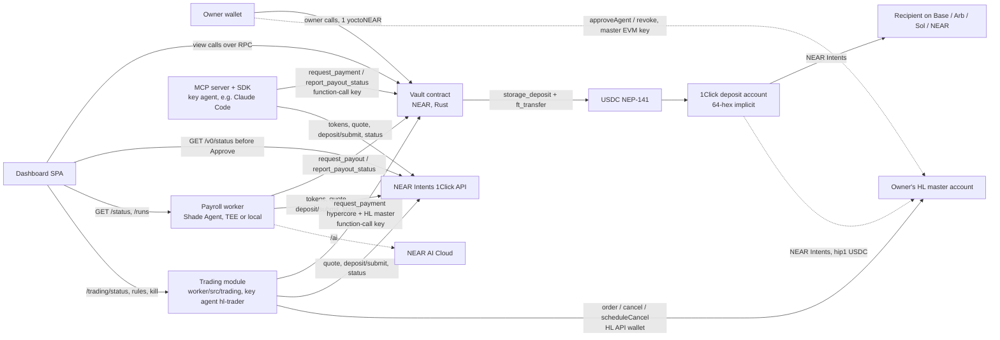

# Architecture

Sources of truth: `docs/adr/0001`–`0005` (decisions and the exact contract interface; 0005 = Hyperliquid trading agent),
`docs/security/audit-2026-11-01.md` and `docs/security/audit-2026-11-03-trading.md` (trust boundaries), `contract/src/payment.rs` (`evaluate_payment`, the check order below). This file summarises them.

## Components

| Component | Path | Role | Holds keys? |
|---|---|---|---|
| Vault contract | `contract/` | Holds USDC; stores policy, agents + mandates, recipients, schedules, payouts, rejections; enforces every rule; transfers USDC | No private keys. Vault account's own full-access key should be deleted after deploy (ADR-0002 §8) |
| Payroll worker | `worker/` | TEE agent `payroll` with a `Fixed` mandate. Every N minutes: `get_due` → 1Click quote → quote check → `request_payout` → `deposit/submit` → poll `/v0/status` → `report_payout_status`. HTTP API `/status`, `/runs`, optional `/ai/*` | Agent key generated inside the TEE (tee mode) or derived from `SPONSOR_PRIVATE_KEY` (local mode, insecure) |
| SDK | `sdk/` | `getBudget`, `listAllowedRecipients`, `quotePayment`, `requestPayment`, `getPaymentStatus`; key-agent setup and revoke scripts | Uses the agent's function-call key passed in by the caller |
| MCP server | `mcp/` | Five `treasury_*` tools over stdio, wraps the SDK | Function-call key in the MCP client's env |
| Dashboard | `dashboard/` | Owner UI. Reads views over RPC; owner calls through wallet-selector; quote check before Approve | None; the wallet signs |
| Trading module | `worker/src/trading/` (same process as the worker, off unless `TRADING_ENABLED=true`, local mode only) | Key agent `hl-trader` with an `Allowlist` mandate (`hypercore` + the owner's HL master). Tops up the master through 1Click when free HL USDC is below the floor. Runs owner-signed (NEP-413) `RuleSetV1` rules in a deterministic tick: perp alarm, dead-man `scheduleCancel`, loss stop, risk guard, at most 2 spot orders per tick. HTTP `/trading/*` (ADR-0005) | `hl-trader` function-call key in `worker/.env`; HL API-wallet key in `TRADING_STATE_DIR/api-wallet.json` (0600). Both plain files on the operator's host |
| Hyperliquid | external | HL master account (owned by the owner's EVM key) holds the trading USDC and positions; the API wallet signs orders for it | — |
| NEAR AI Cloud | external | Assistant inference for `/ai/chat`; output is proposals the owner signs | NEAR AI key in worker env only |
| 1Click | external, mainnet only | Quotes, deposit addresses, cross-chain delivery, refunds | — |

Agent kinds (ADR-0003):
- **Tee**: the owner creates a slot (`add_agent`, kind `Tee`); the enclave calls `register_agent(agent_id, attestation)`; the attestation must match vault-wide approved measurements and PPIDs (Shade Agent v2, ADR-0001). The slot binds to the caller's implicit account. `pin_agent` fixes it to that account. Local mode (`requires_tee = false`, explicit `allow_insecure_local_mode` at init) accepts owner-whitelisted accounts with mock measurements.
- **Key**: the owner registers an account and its public key. Setup A: a sub-account of the owner with a function-call key restricted to `receiver_id = <vault>`, `method_names = ["request_payment", "report_payout_status"]`, 0.25 NEAR allowance.

Schedules (ADR-0004): recipients are an address book (chain, 1Click asset id, address). A schedule names the recipient,
amount, frequency (`Once`, `Weekly`, `Monthly`, `EveryNDays`), end rule and the executing agent. Date rules are identical
in Rust and TypeScript (`docs/frequency-vectors.json`). A schedule more than `overdue_grace_ms` (default 3 days) past due
needs owner approval.

## Payment path

1. **Quote.** The agent calls 1Click `/v0/tokens` (cached) for asset ids, then `/v0/quote` (`dry: false`, `EXACT_INPUT`,
   origin NEAR USDC, `refundTo = vault`, `refundType = ORIGIN_CHAIN`, recipient = destination address, no `msg`). Deadline
   now + 30 min, or + 24 h when the payment will need approval. 1Click returns a `depositAddress` (a fresh 64-hex NEAR
   implicit account).
2. **Local quote check** (worker `src/quote-check.ts`, SDK): recipient, destination asset, amount, refund address,
   64-hex deposit address and deadline must match the request. Any mismatch aborts before signing.
3. **`request_payment`** (key agent) or **`request_payout(schedule_id, …)`** (payroll wrapper), 150 TGas, no deposit.
   The vault runs the checks below. Rejections do not panic: the call succeeds and returns
   `{"Rejected":{"reason","detail"}}`, and known agents get a rejection log entry.
4. **Approval branch.** If the amount is above the mandate's `approval_threshold`, or a scheduled payment is overdue, the
   payout is stored as `PendingApproval` with its deposit address and deadline; nothing is reserved. The owner opens it
   in the dashboard; the dashboard calls 1Click `/v0/status?depositAddress=…` and enables Approve only when the quote
   behind that address matches the payout (recipient, refund to vault, amount, deposit address, deadline). An unknown
   address or a mismatch cannot be overridden. `approve_payout` re-runs checks 1–11 and then continues at step 5.
   Approvals expire with the quote deadline, and after 72 h.
5. **Reserve, then transfer.** Vault `balance`, vault and agent `spent_today`, payment count and schedule state
   (`paid_count`, `next_due_at`) are updated first. Then one batch receipt to the USDC contract:
   `storage_deposit(deposit_address, registration_only)` + `ft_transfer(deposit_address, amount)`. Actions in one receipt
   are atomic.
6. **Callback** `on_transfer_result` (`#[private]`, never panics): on failure it releases every reservation and restores
   the schedule snapshot; the result is `TransferFailed`. On success the payout is `Sent`; the result is `Submitted`.
7. **Delivery.** The agent calls `/v0/deposit/submit` with the NEAR tx hash, polls `/v0/status` until `SUCCESS`, `REFUNDED`
   or `FAILED`, and calls `report_payout_status` (`Confirmed` / `Refunded` / `Failed`). A report is an annotation and
   never moves money.
8. **Refunds** arrive as plain `ft_transfer` to the vault, which cannot observe them. The owner credits them with the
   two-phase `credit_refund` / `sync_surplus` (two `ft_balance_of` reads at least 60 s apart, ADR-0002 amendment).

On testnet, steps 1, 2 and 7 run against a simulated 1Click (`ONECLICK_MODE=simulated`): quotes are synthesised with a
random 64-hex deposit address and status is immediately `SUCCESS`. USDC really moves on NEAR testnet to that account;
nothing is delivered cross-chain. The simulation refuses to run unless the RPC reports `chain_id == "testnet"`.

Status reporting for Key agents' approved payouts: an MCP process usually exits after `pending_approval`, so an approved
payout can stay `Sent`. An ADR-0002 amendment dated 2026-11-02 lets an attested TEE agent report Key agents' payouts;
it is in the working tree and not deployed to the testnet vault.

## Check order in `request_payment`

`evaluate_payment` returns the **first** failing reason. Numbers follow AGENT_ACCESS §3.4 / ADR-0003; S = only for
scheduled requests (`schedule_id` set, ADR-0004).

| # | Code | Condition |
|---|---|---|
| 1 | `VAULT_PAUSED` | global pause |
| 2 | `AGENT_NOT_FOUND` | caller is not an agent's account (not logged) |
| 2 | `AGENT_REVOKED`, `AGENT_PAUSED` | agent status |
| 2 | `ATTESTATION_INVALID` | Tee agent not registered, attestation expired, or image/PPID no longer approved |
| 3 | `AGENT_EXPIRED` | `now > mandate.expires_at` |
| 3 | `TOO_MANY_FAILED_TRANSFERS` | 3 consecutive failed transfers for the agent |
| 3 | `INVALID_REQUEST` | bad arguments (e.g. memo > 140 bytes) |
| 3 | `INVALID_DEPOSIT_ADDRESS` | not a 64-hex implicit account, or the token, the vault, the caller or an agent account |
| S | `SCHEDULE_NOT_FOUND` / `RECIPIENT_NOT_ALLOWED` | unknown schedule or removed recipient |
| 4 | `CHAIN_NOT_ALLOWED` | chain not in `mandate.allowed_chains` (1Click ids: `base`, `arb`, `sol`, `near`, …) |
| 5 | `SCHEDULE_NOT_ACTIVE` (S), `RECIPIENT_NOT_ALLOWED` | S: schedule paused/ended, belongs to another agent, or chain/address differ from its recipient; then mandate rule: Fixed = recipient in `mandate.recipients` (Fixed agents only pay schedules); Allowlist = destination in allowlist; Open = pass |
| 6 | `AMOUNT_MISMATCH` (S) | amount ≠ schedule amount |
| 7 | `NOT_DUE`, `TOO_MANY_FAILED_TRANSFERS`, `PAYOUT_IN_PROGRESS` (S) | next occurrence in the future; 3 failed transfers for this schedule; schedule already has an open payout |
| — | `BELOW_MIN_PAYMENT` | `amount < policy.min_payment` |
| 8 | `PER_TX_LIMIT_EXCEEDED` | `amount > mandate.per_tx_limit` |
| 9 | `AGENT_DAILY_LIMIT_EXCEEDED` | agent `spent_today + amount > mandate.daily_limit` (day rollover first) |
| — | `AGENT_DAILY_COUNT_EXCEEDED` | `payments_today >= mandate.max_payments_per_day` |
| 10 | `VAULT_DAILY_LIMIT_EXCEEDED` | vault `spent_today + amount > policy.daily_limit` |
| 11 | `INSUFFICIENT_BALANCE` | vault balance |
| 12 | → `PendingApproval` (`ABOVE_THRESHOLD` or `OVERDUE_NEEDS_APPROVAL`) | `amount > mandate.approval_threshold`, or S: `now > next_due_at + overdue_grace_ms`. Requires `deposit_expires_at_ms` (else `INVALID_REQUEST`); at most 5 open approvals per agent (`TOO_MANY_PENDING_APPROVALS`) |
| 13 | → reserve + transfer | result `Submitted` or `TransferFailed` |

Example `detail` strings from the testnet vault: `"Per-payment limit for agent 'claudeagent' is 3 USDC; requested 4."`,
`"0x…beef on base is not in the allowlist of agent 'claudeagent'."`, `"The vault holds 0 USDC available; requested 1."`

## Trust boundaries

From ADR-0002, ADR-0003 §11, ADR-0005 and the trust tables of both audits (2026-11-01, 2026-11-03 trading).

| If this is compromised | It can | It cannot | Bounded by |
|---|---|---|---|
| TEE payroll agent, honest image | nothing beyond its code | choose amounts, recipients or dates | mandate, schedules, vault policy |
| Operator of the TEE image | money-relevant config is pinned in the measured compose (H1 fix); can still bind an unbound or expired slot with the approved image | change amounts/dates, pay schedules that are not due, exceed limits, approve, withdraw | exact schedule amount once per due date; agent and vault daily limits; `pin_agent` |
| Key agent (leaked key, prompt-injected model, malicious MCP client) | pay any address it quotes, whatever destination it declares, within its limits; park up to 5 payments for approval; mislabel 1Click outcomes | call other methods or contracts, transfer NEAR, exceed limits, approve | per-tx, agent daily amount and count, min payment, expiry, vault daily limit; 0.25 NEAR gas allowance |
| Worker host in local mode | everything a key agent can, for the payroll slot | owner actions | same as key agent |
| Dashboard (XSS, dependency) | use the wallet login function-call key, which after the audit fixes can only pause or apply reversible restrictions (e.g. `remove_schedule`, `reject_payout` that keeps the date); show a misleading transaction | 1-yocto owner methods without a wallet confirmation | owner's wallet confirmation |
| NEAR AI model | produce misleading proposals | sign or send anything | owner signature; proposals validated against fresh state |
| 1Click | return a deposit address that pays elsewhere; keep funds; mis-report status | pull funds from the vault | the payer's mandate; refunds go to `refundTo = vault` |
| `hl-trader` NEAR key (leaked from `worker/.env` or the dashboard during setup) | send up to its limits to **any** NEAR account: the vault checks only the declared `hypercore` destination, and the deposit address can be any 64-hex account (audit 2026-11-03 H1) | call other methods, exceed the mandate, approve | per-tx, daily amount and count, expiry, vault daily limit. With `approval_threshold` 0 (first mainnet session), every top-up waits for the owner's approval, which comes after the dashboard's 1Click quote check |
| HL API-wallet key (leak, or the local host) | lose or route away **everything on the HL master**: trade at any price (wash trades on thin books), leveraged perps incl. HIP-3 (not detected), spot↔perp moves, possibly `vaultTransfer` to an attacker's HL vault (not verified), deploy / priority-bid burns (audit H2) | `withdraw3`, `usdSend`, `spotSend`, `approveAgent` (user-signed, master key only) | only the amount the vault sent to HL; `valid_until`; owner revokes it on HL with the master key |
| Trading module host (local mode) | both of the above; skip its own hard limits, perp alarm and loss stop; replay older signed rule sets from the state dir | owner actions on NEAR or HL | vault mandate; HL balance |
| Trading worker / `VITE_WORKER_URL` (wrong or stale) | show an attacker's API-wallet address for the owner to approve, or a wrong HL account (audit M7) | sign anything | owner compares the address with the worker console before approving |
| NEAR AI model (trading) | propose aggressive rules inside the env hard limits | widen hard limits, change the funding size or destination, place orders | owner reviews the dashboard-rendered card and signs its hash |
| Owner HL master EVM key | everything on HL: revoke the API wallet, withdraw, return funds | anything in the vault | nothing (second root of trust; use a hardware wallet) |
| Owner full-access key | everything | — | nothing (use a hardware wallet or multisig as owner) |

Key facts behind the table:
- The vault cannot see 1Click quotes. It checks the destination the agent **declares**. For a TEE agent that is meaningful
  (its code is attested to quote honestly). For a key agent only the limits bind. On-chain verification of the 1Click
  quote signature is open for v2 (ADR-0002).
- The approval threshold can be split into smaller payments; only daily amount and count limits bind.
- Pausing (`pause`, `pause_agent`, `pause_schedule`) needs no deposit, so it works from a function-call key. Irreversible
  owner actions (`revoke_agent`, `unbind_agent`, `withdraw`, `approve_payout`, `update_contract`, …) need 1 yoctoNEAR.
- The owner is never locked out: `withdraw` ignores pause and agent state; `force_settle_transfer` settles a payout whose
  callback never ran (after 1 h).
- Trading kill switch: `POST /trading/kill` halts the bot (sticky until new rules are signed), cancels all orders and
  sets the dead-man to now + 6 s. It works while NEAR RPC is down, if the owner session is still valid. Then the
  dashboard calls `pause_agent`, which needs RPC and the wallet. Positions stay open. The authoritative stop is revoking
  the API wallet on Hyperliquid. Full list of what the vault does not protect: `README.md`.
